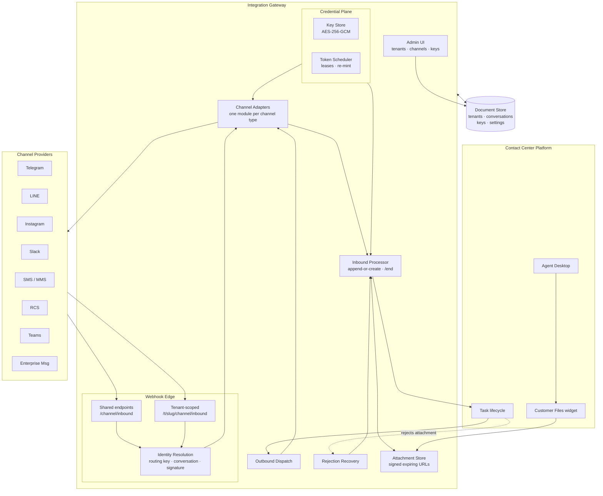

# Multi-Tenant Integration Gateway — Case Study

## Overview

Designed and built middleware that bridges eight consumer and enterprise messaging platforms — Telegram, LINE, Instagram DM, Slack DM, SMS/MMS, RCS, Microsoft Teams and an enterprise messaging platform — into a cloud contact center platform's custom-channel API, for any number of tenant organizations from a single deployment.

The division of labour is the whole design. The gateway owns the **channel wire**: every provider integration, every credential, every webhook, every attachment. The contact center platform keeps owning the **task lifecycle**: routing, agent presentation, transcripts, reporting. Adding a ninth channel is one adapter file and a field definition; the platform never changes, it just gains another door.

Around that sit the parts that make it operable rather than demonstrable: a single encrypted key store that every tenant and channel *references* rather than copies, OAuth token refresh that runs in the background under database leases so concurrent instances never collide, webhook identity resolution that works three different ways because three classes of webhook carry three different kinds of evidence, and a recovery path for the specific case where the downstream platform accepts a message and rejects its attachment.

---

## The Short Version

**Multi-tenancy is not a field on a record. It is the question "whose traffic is this?" asked at every entry point — and answered differently at each one.**

| The decision | Instead of |
|---|---|
| Credentials belong to the **tenant**; channels reference them by name | Every channel carrying its own copy of the platform credentials |
| A routing key must be **unique across all tenants**, enforced at write time | Hoping a shared webhook URL resolves to the right tenant |
| Three webhook classes resolve identity **three different ways** | One scheme forced onto payloads that cannot support it |
| Keys are **referenced, never copied**; an in-use key cannot be deleted | Rotating a credential in nine places and missing the tenth |
| The encryption key's fingerprint is recorded; a mismatch **refuses to write** | Silently encrypting new secrets with a key that cannot read the old ones |
| Token refresh takes a **database lease** | Two instances racing to refresh one token and invalidating it |
| A transient provider error **never invalidates** a stored credential | Treating a 503 as a revoked token |
| Attachment rejection triggers a **retry ladder**, not an apology to the customer | "Please try sending that again" |
| Webhooks are acknowledged immediately and processed after | Providers timing out and retrying into duplicate work |

Config is data, edited live. The predecessor needed an environment-variable change and a redeploy to add a tenant; this one needs a form.

If you read one more section, read [Design Decisions](#design-decisions), then [Stated Limitations](#stated-limitations).

---

## The Problem

Connecting a messaging channel to a contact center is a solved problem exactly once — for one channel, one organization, one deployment. It stops being solved the moment you need the second of anything.

1. **Per-deployment tenancy does not scale past a demo.** The conventional pattern is one deployment per organization, configured by environment variables. Ten organizations means ten deployments, ten credential sets, ten upgrade paths, and a redeploy to change a phone number.

2. **Every channel is differently shaped.** Telegram authenticates webhooks with a secret header; LINE identifies the recipient by bot user ID; Teams uses an Azure Bot App ID; SMS arrives with a service number. There is no common identifier, no common signature scheme, and no common attachment model. A single abstraction imposed over all of them either leaks the differences or hides behaviour that operators need.

3. **Credentials multiply and then rot.** Bot tokens, webhook secrets, service keys, OAuth client credentials, access tokens and refresh tokens — per channel, per tenant. Stored in environment variables they cannot be rotated without a deploy; copied per channel they cannot be rotated at all without finding every copy.

4. **OAuth refresh is a distributed-systems problem disguised as a chore.** Two instances refreshing the same token concurrently can invalidate it. A network blip misread as a revocation deletes a working credential. A refresh token that expires silently takes the integration down at 3am.

5. **The downstream platform has opinions you discover in production.** Message-size policies that reject rather than truncate, attachment scanning that drops a file after accepting its message, a one-open-conversation rule that fails the second task. None of these are failures of the integration, and all of them look like failures to the customer.

---

## Architecture

### High-Level Design



> Full diagrams — the record hierarchy, the message lifecycle, the three identity-resolution paths, the token-refresh lease and the rejection-recovery ladder — are in [`/architecture/diagrams.md`](architecture/diagrams.md).

### The Record Hierarchy

Four record types, each pointing at the one above it. This shape is what makes a single deployment serve many organizations.

| Record | Holds | Scope |
|---|---|---|
| **Platform token** | OAuth credentials for one organization's service app; kept fresh in the background | Referenced *by name* |
| **Tenant** | One customer organization: which platform token to use, region, org identifier, references to its two webhook secrets | One per organization |
| **Channel** | One endpoint — a bot, a phone number, a workspace: its routing key, references to its keys, and the platform channel it maps to | Many per tenant |
| **Conversation** | Links a live task to its tenant, channel and customer; created on first message, deleted when the task ends | One per open task |

**Channels do not hold platform credentials.** Every call made on a channel's behalf uses its *tenant's* token. Set it once per organization and every channel beneath it inherits — including channels added later.

---

## Design Decisions

### 1. Credentials Belong to the Tenant, Not the Channel

**Decision:** A channel references its tenant's platform token by name. It never stores one.

**Why:** The alternative looks harmless — put the credential on the channel that uses it — and it is the decision that makes rotation impossible. An organization with nine channels has nine copies, and rotating means finding all nine. Worse, nothing detects the one that was missed until it fails in production.

**Trade-off:** A channel cannot use different credentials from its siblings. That is intended; an organization that genuinely needs two credential sets is two tenants.

### 2. A Routing Key Is Unique Across *All* Tenants, Enforced at Write Time

**Decision:** Every channel declares a routing key — the identifier that arrives in its provider's webhook. No two channels of the same type may share one, across the entire deployment, and the admin UI refuses a duplicate rather than accepting it.

**Why:** This is the constraint that makes a shared webhook URL safe. Because the key is globally unique, it maps to exactly one channel and therefore one tenant, with no ambiguity to resolve at request time. Enforcing it at write time turns a runtime routing hazard into a configuration error a human sees immediately.

**Trade-off:** Two tenants cannot share one bot or one phone number. Correct — if they did, there would be no principled way to decide whose conversation an inbound message belongs to.

### 3. Three Webhook Classes, Three Identity Resolutions

**Decision:** Tenant identity is resolved by whatever the payload actually carries, which differs by webhook class.

| Webhook class | Resolved by |
|---|---|
| Channel inbound (customer message) | The **routing key** in the request |
| Outbound (agent or flow reply) | The **task id** → stored conversation → its tenant |
| Lifecycle events | The tenant whose **subscription secret verifies the signature**, then filtered to that tenant's channels |

**Why:** A single scheme would require every payload to carry a tenant identifier, and none of them do — these are third-party payload shapes nobody controls. Forcing one scheme means either adding a query parameter to every provider configuration (fragile, and silently wrong if mis-entered) or guessing.

Resolving by signature verification for lifecycle events is the subtle one: it is an identity lookup and an authenticity check in the same operation. A payload that verifies against a tenant's secret both *is* that tenant's and is *proven* to be.

**Trade-off:** Three code paths to maintain and reason about. Accepted, because the alternative is one path with three undocumented special cases in it.

### 4. Both Addressing Forms, Simultaneously

**Decision:** Every webhook exists at a shared path and a tenant-scoped path at the same time. Operators choose per tenant.

**Why:** Shared URLs are simpler to configure and are correct because of decision 2. Tenant-scoped URLs accept only that tenant's traffic, which some organizations require and which makes a misconfiguration fail loudly rather than route oddly. Neither is right for everyone, and supporting both costs one routing prefix.

### 5. The Key Store Holds Values; Everything Else Holds References

**Decision:** One encrypted store for both directions of authentication — keys the gateway presents to vendors, and keys callers present to the gateway. Tenants and channels reference entries by name.

**Why:** Reference rather than copy means changing a value takes effect everywhere at once. The store knows where each key is used, so an in-use key cannot be deleted. Revealing a value is audit-logged by name, and values never appear in API responses or logs otherwise.

One channel's webhook secret is stored only as a **hash**, because verification needs only comparison — so the record cannot leak a credential it does not hold.

**Trade-off:** An indirection between a channel and the secret it uses. Worth it the first time a credential is rotated.

### 6. Record the Encryption Key's Fingerprint and Refuse on Mismatch

**Decision:** The fingerprint of the encryption key is stored alongside the encrypted data. A gateway started with a different key **refuses to write secrets** rather than proceeding.

**Why:** Starting with the wrong key is not an exotic failure — it is a misconfigured environment on a new instance. Without the check, that instance happily encrypts new secrets with a key nothing else has while being unable to read the existing ones, producing a store where some records are readable and some are not, with no record of which is which. Refusing to write keeps the damage at zero.

Pre-existing plaintext records are migrated on first start, so enabling encryption is not a manual data operation.

### 7. Token Refresh Takes a Lease

**Decision:** Background refresh acquires a short database lease before refreshing a token, so multiple gateway instances never refresh the same one concurrently.

**Why:** Concurrent refresh against most OAuth providers invalidates the token — the second refresh presents a rotated-away refresh token and the provider revokes the grant. This is the classic multi-instance failure, it only appears under horizontal scaling, and it takes down an integration rather than degrading it.

**Two companion rules matter as much:**

- **A transient provider error never invalidates stored credentials.** Network failures and 5xx responses are recorded as the last error and surfaced in the UI; they do not clear a token. Treating a 503 as a revocation turns a provider's bad minute into an outage requiring manual re-authorization.
- **A token minted through an organization admin integration is re-minted automatically** if its refresh token stops working — so the common expiry path self-heals instead of paging someone.

### 8. Rejection Recovery Is a Path, Not an Error Message

**Decision:** When the downstream platform rejects an attachment, the gateway retries in a defined ladder rather than telling the customer to resend.

```
image rejected  →  wrap in a one-page PDF, resend as a real attachment
PDF rejected    →  resend as text carrying a signed, expiring link
non-image       →  resend as text carrying a signed, expiring link
```

**Why:** The rejection is a property of the receiving organization's messaging policy, not of the customer's file. "Please try again" asks a customer to solve a configuration problem they cannot see. Wrapping an image in a PDF keeps it viewable inside the agent's desktop, which is the outcome the agent actually needed.

A related case: the platform may accept a message and then **drop its attachment** during content scanning. The gateway detects that and follows up with the file's secure link, so the agent gets the file rather than a blocked placeholder.

And when the platform refuses a second conversation for a customer who already has one open, the gateway ends the stale task and recovers, rather than surfacing a protocol error.

### 9. Acknowledge Immediately, Process Afterwards

**Decision:** Every webhook returns 200 at once; work happens after the response.

**Why:** Providers retry on timeout, and a retry is a duplicate message to a live agent. Returning immediately means slow downstream work can never manufacture duplicates. The honest consequence is stated in the limitations: this does not make the gateway idempotent against a provider's *own* retries.

### 10. Configuration Is Data, Edited Live

**Decision:** Tenants, channels, keys and settings live in the database and are managed through an admin interface. No environment variables, no redeploy.

**Why:** The predecessor to this system was configured by environment variables and deployed one organization per instance. Adding a tenant meant a deployment. Beyond the operational cost, that model makes configuration invisible — there is no page showing which channels exist, which keys they use, or where a key is used.

**Trade-off:** An admin interface is now attack surface. It is admin-authenticated, login-throttled, under a strict content security policy, and secret reveals are audit-logged.

---

## Technical Patterns

Sanitized design patterns with pseudocode are documented in the [`/patterns/`](patterns/) directory:

| Pattern | Description |
|---|---|
| [Tenant Model](patterns/tenant-model.md) | Record hierarchy, credential inheritance, routing-key uniqueness |
| [Webhook Identity](patterns/webhook-identity.md) | Three resolution strategies, dual addressing, acknowledge-then-process |
| [Credential Store](patterns/credential-store.md) | Encryption at rest, key fingerprinting, reference-not-copy, hashed secrets |
| [Token Lifecycle](patterns/token-lifecycle.md) | Background refresh, database leases, transient-error isolation, re-minting |
| [Channel Adapters](patterns/channel-adapters.md) | The adapter boundary, and surfacing channel differences instead of hiding them |
| [Rejection Recovery](patterns/rejection-recovery.md) | The retry ladder, post-scan drops, attachment hosting and retention |

---

## Technical Stack

| Layer | Technology |
|---|---|
| **Runtime** | Node.js |
| **Framework** | Express |
| **Persistence** | MongoDB — tenants, conversations, keys, settings |
| **File storage** | GridFS, served via signed expiring URLs with a host allowlist |
| **Encryption** | AES-256-GCM, key held in a managed parameter store |
| **Authentication** | JWT for users, API keys for machine-to-machine, OAuth 2.0 outbound |
| **Signature verification** | HMAC with constant-time comparison |
| **Admin UI** | Server-rendered, strict content security policy |
| **Containerization** | OCI container |
| **Orchestration** | Serverless containers behind an application load balancer |
| **Scale** | ~19,600 lines across 52 modules; 8 channel adapters, 12 services, 13 route groups |

---

## What the Architecture Produces

- **One deployment serving any number of organizations**, where the predecessor needed one deployment each
- **A channel added in one adapter file**, with no change to the contact center platform
- **Credential rotation in one place**, taking effect everywhere that references it, with deletion blocked while in use
- **Token refresh that survives horizontal scaling**, through leases, and survives provider flakiness, through transient-error isolation
- **Attachments that reach the agent** even when the receiving organization's policy rejects their original form
- **Configuration visible as a page** rather than inferred from environment variables across deployments

---

## Stated Limitations

A case study that lists only what works is marketing. These are true as written.

**The channel adapters were ported, not invented here.** They came from a standalone single-tenant middleware. What this work contributed is everything around them: the tenant model, the key store, token lifecycle management, identity resolution, the admin interface, attachment hosting and rejection recovery. The shared inbound processor is the same module in both systems.

**Webhook deliveries are not deduplicated.** A provider retry or a duplicate platform event can produce a duplicate message. Acknowledging immediately prevents the gateway from *causing* retries; it does not make the gateway idempotent against them. This is the most significant known gap.

**The tenant document is read-modify-written whole.** Two administrators editing one tenant concurrently will overwrite each other. Acceptable at the intended scale, and stated rather than discovered.

**Channel capability is uneven and cannot be abstracted away.** One platform enforces a 24-hour reply window; another requires the customer to add the account before messaging; another is restricted to a single corporate directory; another splits long messages at the carrier. Outbound file support differs per channel — several fall back to a link. These are published per channel rather than hidden behind a uniform interface that would misrepresent them.

**Some rejection recovery is a workaround for downstream behaviour.** The PDF-wrapping ladder exists because a content scan drops files it should pass. That is a defect in another system; the gateway compensates rather than fixes.

**No transcript view.** Open conversations are listed; transcript retrieval belongs to the platform's own capture API and was deliberately not duplicated.

---

## Lessons Learned

### 1. Multi-Tenancy Is an Identity Question, Asked at Every Door
It is tempting to model tenancy as a column and move on. In practice the real work is that every entry point receives a payload shaped by someone else, and each one must answer "whose is this?" from whatever evidence it happens to carry. Three entry classes needed three answers. Recognising that early — rather than forcing one scheme and special-casing the failures — produced a system where each resolution path is simple and explainable.

### 2. Make Uniqueness a Write-Time Constraint, Not a Runtime Hope
The routing-key rule is one line of validation that eliminates an entire class of runtime ambiguity. Any time a system must later ask "which of these does this belong to?", it is worth asking whether the answer could have been guaranteed at configuration time instead. A configuration error a human sees immediately beats a routing error discovered from a customer complaint.

### 3. Reference, Never Copy, Anything That Will Need Rotating
Copying a credential is free at write time and expensive forever after. The indirection feels like overhead right up to the first rotation, at which point it is the only reason the rotation is possible at all. The corollary matters too: if values are referenced, the system can tell you where each one is used — and can refuse to delete one that is still live.

### 4. Distinguish "This Credential Is Bad" From "The Provider Is Having a Bad Minute"
Collapsing those two turns transient failures into outages that need human re-authorization, and it does so at exactly the moment the provider is already struggling. Every integration that stores a credential needs an explicit policy for which errors invalidate it — and the default should be none of them.

### 5. Concurrency Bugs in Credential Refresh Are Invisible Until They Are Catastrophic
A single instance never races with itself, so the defect does not exist in development and does not exist in a one-instance deployment. It appears on the day of horizontal scaling, and its symptom is a revoked grant rather than an error. A lease is cheap; discovering you needed one is not.

### 6. Compensate for Downstream Behaviour, but Say That Is What You Are Doing
The retry ladder is good engineering and also a workaround. Documenting it as both is what stops it from being mistaken for intended design — and what makes it removable if the underlying behaviour is ever fixed. Compensations that go unlabelled calcify into permanent complexity nobody can justify.
