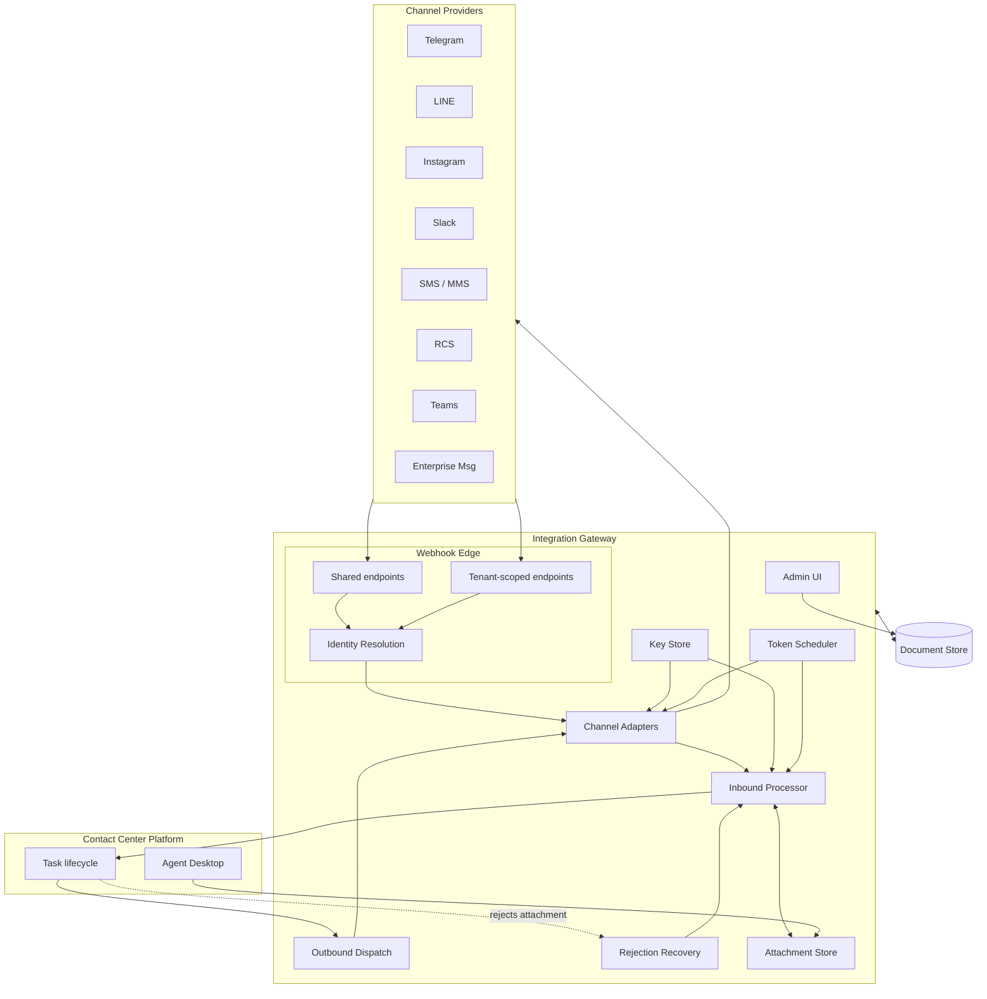
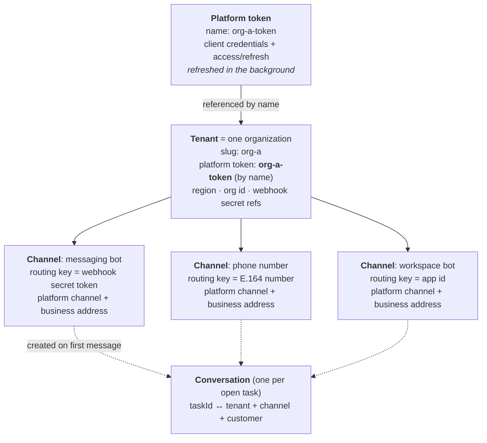
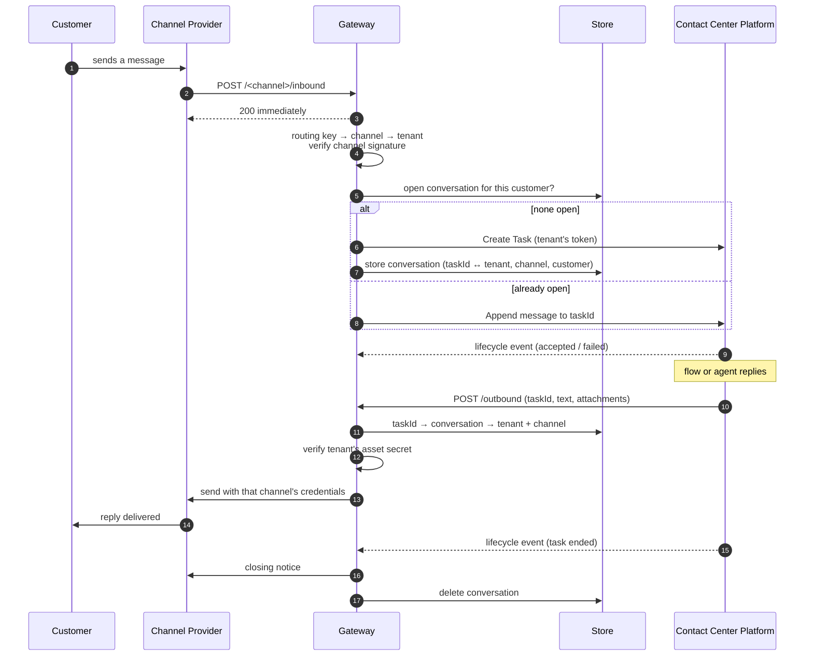
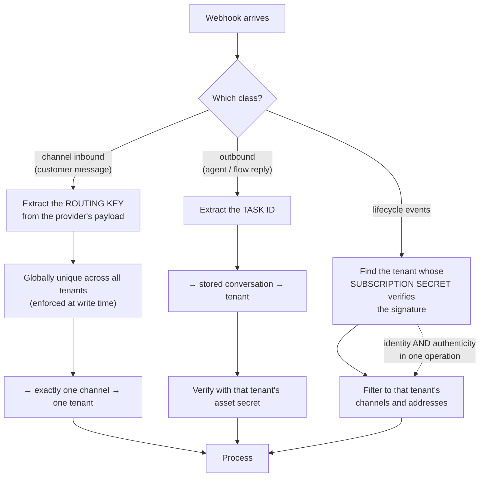
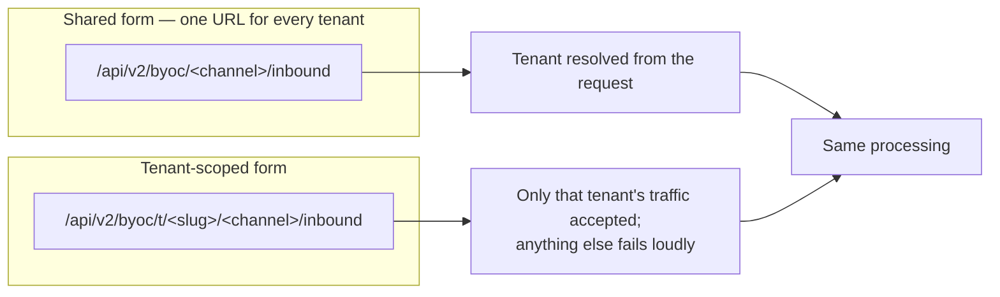
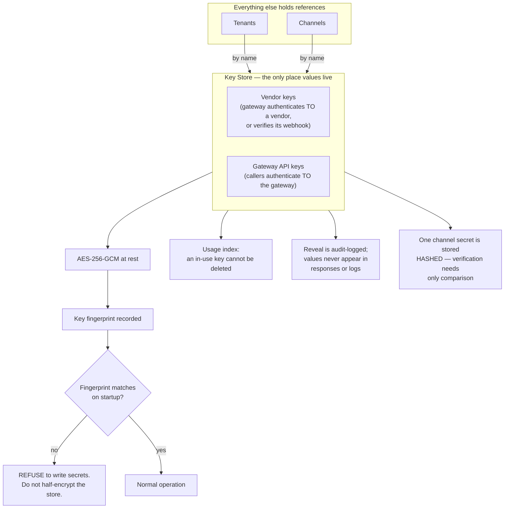
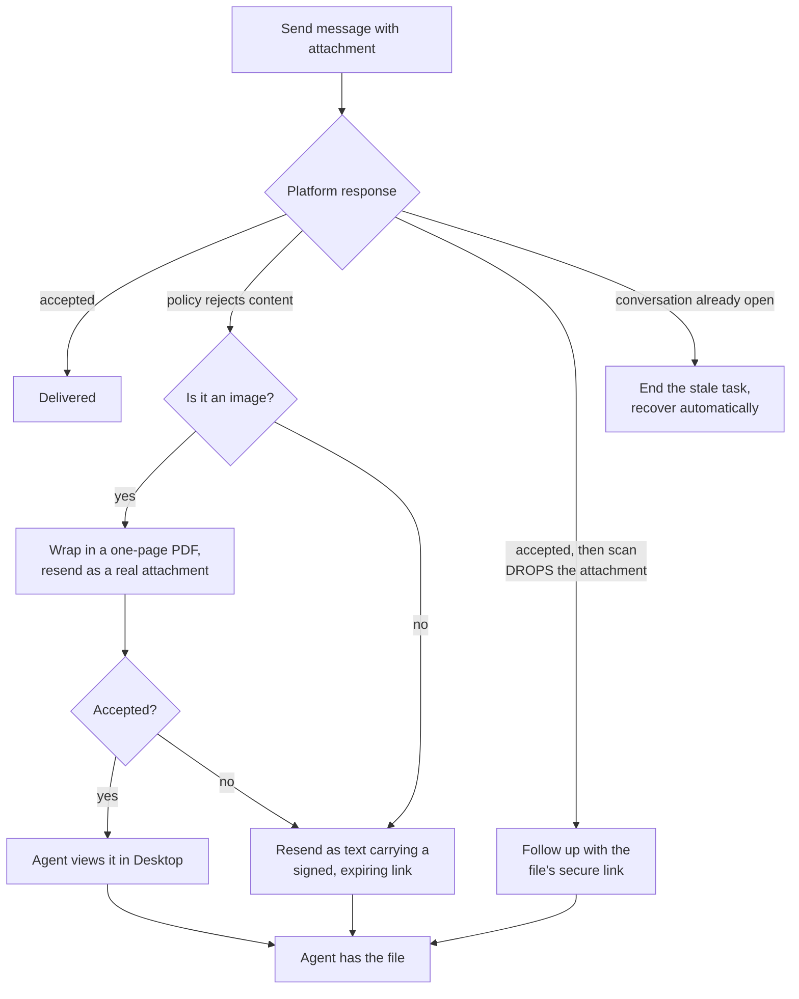
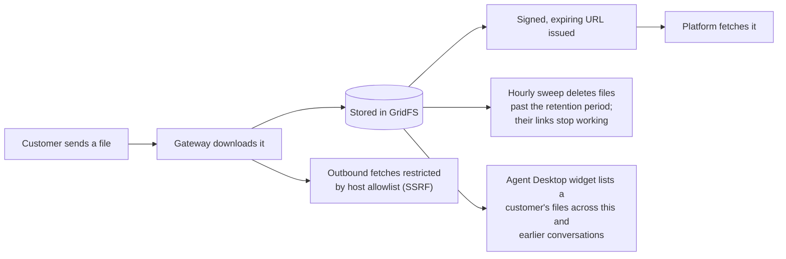

# Architecture Diagrams

Detailed diagrams for the multi-tenant integration gateway. All diagrams describe
design and control flow; none describe implementation internals.

---

## 1. High-Level System Architecture



---

## 2. The Record Hierarchy

Each record points at the one above it. This shape is what lets one deployment
serve many organizations.



> **Channels hold no platform credentials.** Every call made for a channel uses
> its tenant's token. Set once per organization; every channel inherits,
> including ones added later.

---

## 3. Message Lifecycle



---

## 4. Three Identity Resolutions

Each webhook class is resolved by whatever evidence its payload actually
carries. No scheme is forced onto a payload shape nobody controls.



### Routing keys by channel type

| Channel | Routing key | Arrives as |
|---|---|---|
| Messaging bot A | Webhook secret token | Request header |
| Messaging bot B | Bot user id | `destination` field |
| Social DM | Business account id | Entry object id |
| Workspace DM | Workspace/team id | `team_id` |
| SMS / MMS | Service number (E.164) | `serviceNumber` |
| RCS | Application id | `rcsAppID` |
| Enterprise chat | Bot application id | Recipient id |
| Platform messaging | Subscription id | Top-level `id` |

---

## 5. Dual Addressing



Both forms are live simultaneously; operators choose per tenant. Shared URLs are
safe *because* routing keys are globally unique.

---

## 6. Token Refresh Under a Lease

```mermaid
sequenceDiagram
    participant A as Instance A
    participant B as Instance B
    participant DB as Store
    participant P as OAuth Provider

    Note over A,B: both wake on the refresh schedule
    A->>DB: acquire lease on token X
    B->>DB: acquire lease on token X
    DB-->>A: granted
    DB-->>B: denied — already leased
    Note over B: skips; no concurrent refresh
    A->>P: refresh
    alt success
        P-->>A: new access + refresh token
        A->>DB: store, release lease
    else transient error (network / 5xx)
        P-->>A: failure
        A->>DB: record last error, release lease
        Note over A,DB: credential NOT invalidated
    else refresh token rejected
        P-->>A: invalid_grant
        A->>P: re-mint via org admin integration
        P-->>A: fresh token
        A->>DB: store, release lease
    end
```

> Concurrent refresh is the classic multi-instance failure: the second refresh
> presents a rotated-away token and the provider revokes the grant. It does not
> exist on one instance, and appears the day you scale out.

---

## 7. Credential Store



---

## 8. Rejection Recovery Ladder



> The rejection is a property of the receiving organization's policy, not of the
> customer's file. Asking a customer to resend makes them solve a configuration
> problem they cannot see.

---

## 9. Attachment Handling


