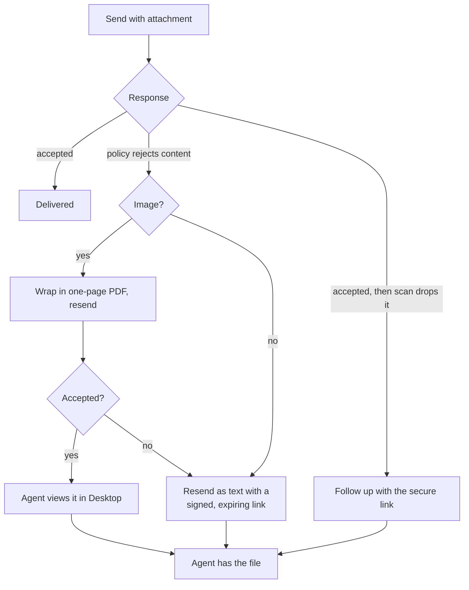

# Rejection Recovery Pattern

The downstream platform can accept a message and reject its attachment, or
accept both and drop the attachment during scanning. Neither is the customer's
fault, and neither should produce "please try again."

---

## The Ladder

```
send(message):
    result = platform.send(message)
    if result.ok: return

    if result.reason == CONTENT_REJECTED:
        if isImage(message.attachment):
            pdf = wrapInSinglePagePdf(message.attachment)
            if platform.send(withAttachment(message, pdf)).ok: return
        return platform.send(asTextWithSignedLink(message))

    if result.reason == CONVERSATION_ALREADY_OPEN:
        endStaleTask(message.customer, message.channel)
        return retryOnce(message)
```



---

## Why Wrap an Image in a PDF

It looks like a hack and it is the right outcome. The rejection comes from the
receiving organization's messaging policy, which may permit documents while
declining image types. The customer's photo is unobjectionable; its *container*
is what the policy refuses.

Re-containing it means the agent sees the photo **inside the desktop** rather
than clicking a link that navigates their tab away. A link is the fallback, not
the goal, because for an agent mid-conversation the difference between viewing
in place and leaving the application is the difference between useful and
ignored.

Links the gateway does emit are suffixed so a click downloads rather than
navigates — a detail that exists because navigating away can drop the agent's
session.

---

## Post-Scan Drops Are a Separate Case

The platform may accept a message, return success, and then remove the
attachment during content scanning. From the gateway's side the send
*succeeded*; the agent sees a blocked placeholder.

```
onMessageAppended(event):
    if event.indicatesDroppedAttachments():
        followUpWithSecureLink(event.taskId, originalAttachment)
```

Detecting this requires reading the lifecycle event rather than the send
response, which is the only reason it was found. A naive implementation
considers the job done at the 200.

---

## Bound the Compensation

```
RECOVERY_WINDOW = 5 minutes
```

Recovery applies only to rejections arriving within a short window of the
original send. Without a bound, a late event could trigger a resend into a
conversation that has moved on — compensating for a problem that is no longer
there, in front of a customer who has stopped talking about it.

---

## Attachment Hosting

```
inbound file -> download -> store (GridFS) -> issue signed expiring URL
                                           -> platform fetches it
                                           -> hourly sweep deletes past retention
```

- **Signed and expiring**, so a URL leaked from a transcript stops working.
- **Host allowlist** on outbound fetches, because a URL supplied by a third
  party is an SSRF vector.
- **Retention sweep** deletes files and invalidates their links together, so
  there is no window where a link resolves to nothing versus resolves to
  something it shouldn't.

A desktop widget lists a customer's files across the current and earlier
conversations, reading from the same store — which is the payoff for hosting
them rather than passing provider URLs straight through.

---

## Say That It Is a Workaround

The PDF ladder is good engineering **and** a compensation for a defect in
another system — a content scan that drops files it should pass. Both are true
and both are documented.

Labelling it matters for two reasons. It stops the behaviour being mistaken for
intended design by whoever maintains this next. And it makes the code
removable: when the downstream behaviour is fixed, there is a written record of
exactly what this was for and what test would show it is no longer needed.

**Compensations that go unlabelled calcify into permanent complexity nobody can
justify and nobody dares delete.**
